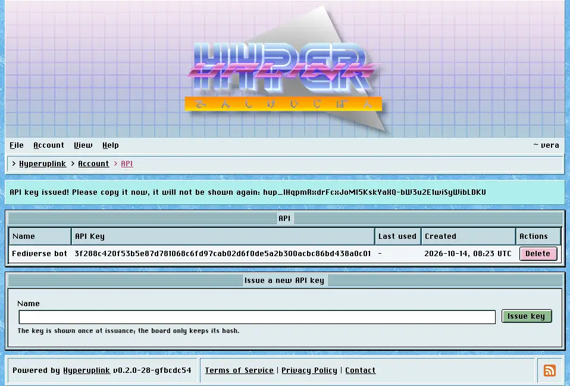

# API keys

The board speaks JSON as well as HTML, over an interface that listens on a
port of its own, 3001 unless whoever runs the board moved it, under the path
`/api/v1`. Reading, posting, voting, searching and reporting work through it,
and so does everything under _Account_ and, for administrators, everything
under _Administration_. Signing up and signing in through an OAuth provider
don't, because an API key takes the place of the browser session.



## Guests

A request without a key is served as a guest and gets what a guest gets in
the browser: whatever the default permission on the
[permissions]({{ manual "admin/permissions" }}) page grants, and never more
than reading. The description at `/api/v1` is open to everyone and its
`guests` field shows whether the board serves guests at all, because the
administrator can close the API to them on the
[General]({{ manual "admin/general" }}) page without changing the web side.
A closed API rejects every request without a key, apart from that description
and the sign-in below.

## Signing in

A client that knows your username and password obtains a key on its own:

```sh
curl -X POST http://board.example:3001/api/v1/session \
  -H "Content-Type: application/json" \
  -d '{"username": "vera", "password": "...", "name": "neonmodem on laptop"}'
```

The response holds the new key in `token`, exactly once, and the key then
appears on this page like one issued here. An account with two-factor
authentication adds the current code from the authenticator app as
`otp_code`; a sign-in without it is rejected with the code `err_otp_required`,
which is how a client knows to ask for one. Sign-ins are limited to ten per
minute from one address. Accounts that signed up through an OAuth provider
have no password and issue their keys on this page instead.

## Issuing a key

_Account_ → _Security_ → _API_ lists your keys and issues new ones. A key takes
a name, which is there for telling your keys apart rather than for anything the
board does with it, and the key itself is shown exactly once, in the message at
the top of the page right after it was issued, so copy it there and then. The
board only keeps a hash, which is what the _API Key_ column shows. Nobody can
read your key back to you, the administrator included, and a key that got away
is deleted and reissued rather than recovered.

_Last used_ is updated when a key authenticates a request, at most once a
minute, which is how you tell a key in daily use apart from one you created in
March and forgot about. _Delete_ revokes a key immediately, and a script still
holding it gets a 401 on its next request. The same list is available to a
client at `/api/v1/account/keys`, which issues and revokes keys as well, and
`DELETE /api/v1/session` revokes the key the request itself was made with.

## Using a key

Every request sends the key as a bearer token:

```sh
curl -H "Authorization: Bearer hup_yourkeyhere" \
  http://board.example:3001/api/v1/session
```

That call returns the account the key belongs to and the level you have in
every category, which makes it the first call to make when you're checking
whether a key works at all. `/api/v1/forums` lists the forums you may read with
your permissions in each, `/api/v1/topics` the newest activity across them, and
the documentation at `/api/v1/docs/` describes every call with the fields it
takes and returns. A key acts as you, it reads what you may read and writes
where you may write and nothing beyond that. Handing a key to a script,
however, gives it your account, and it needs the same thought as handing over
your password.

The page itself: [Account → Security → API]({{ hrefTo "account/api" }})
